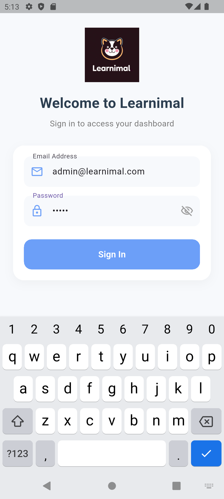
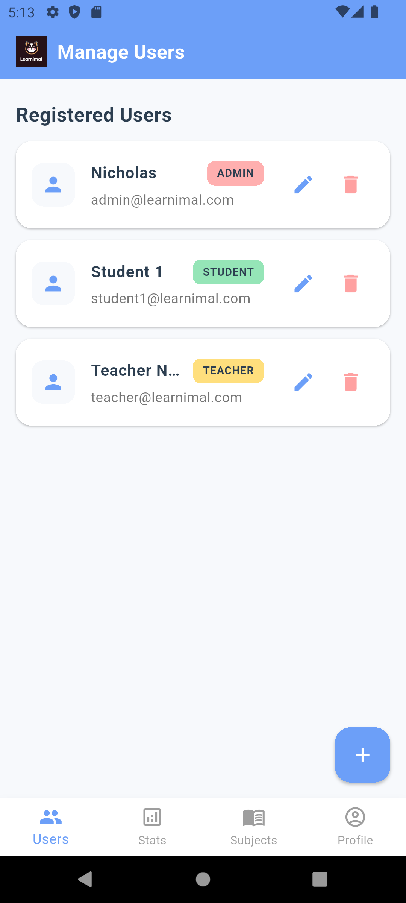
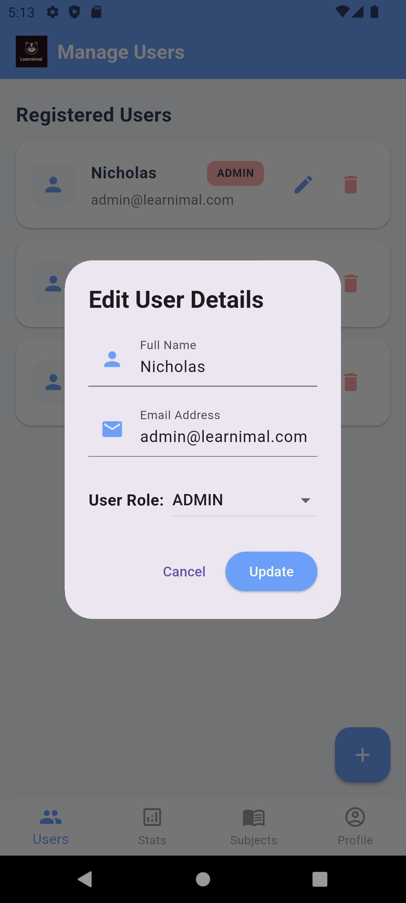
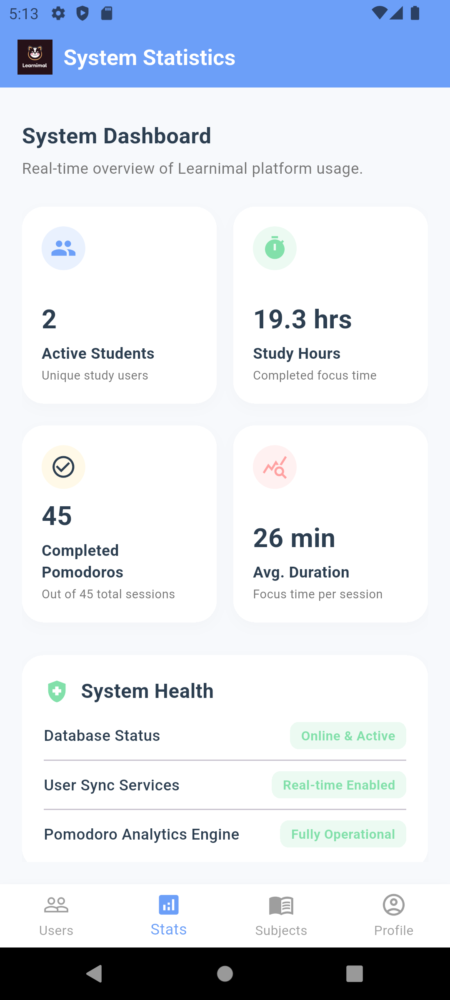
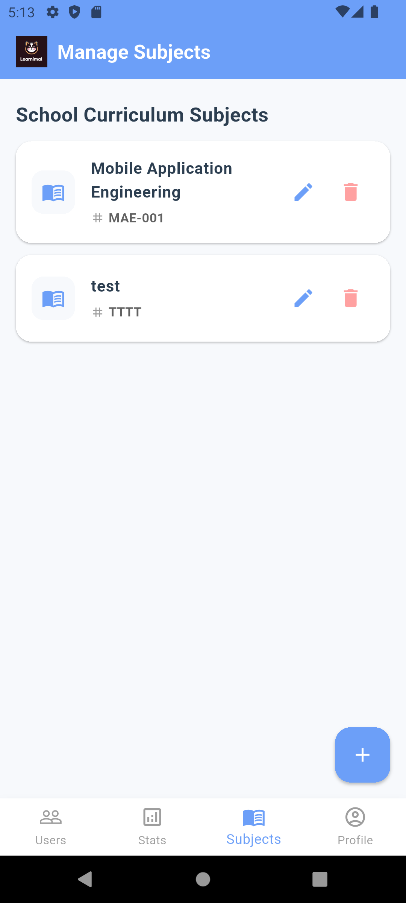
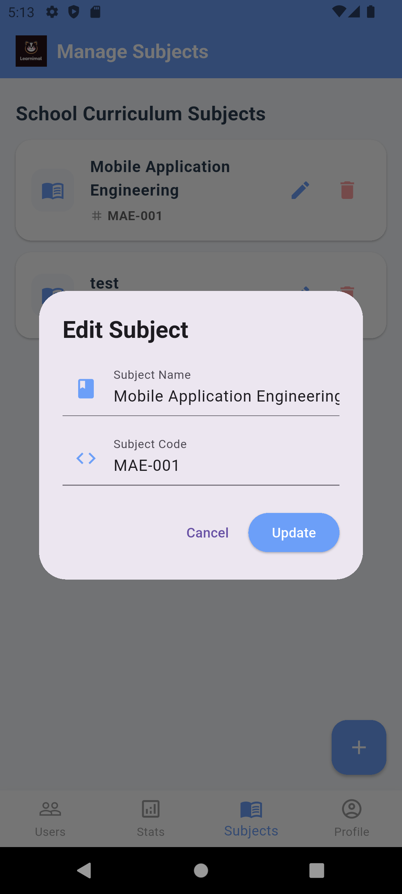
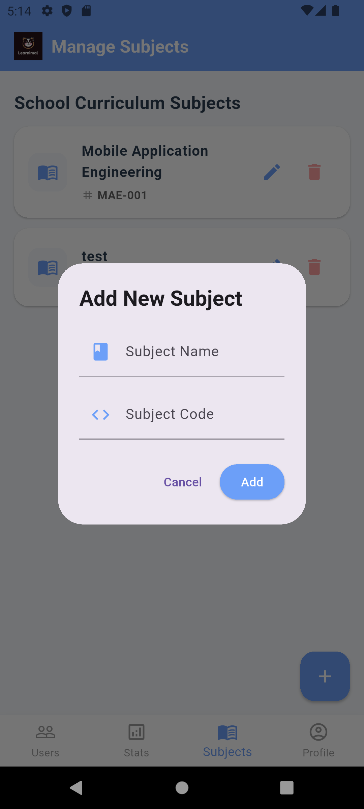
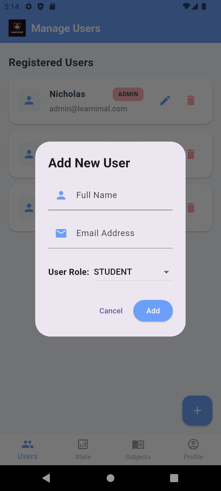
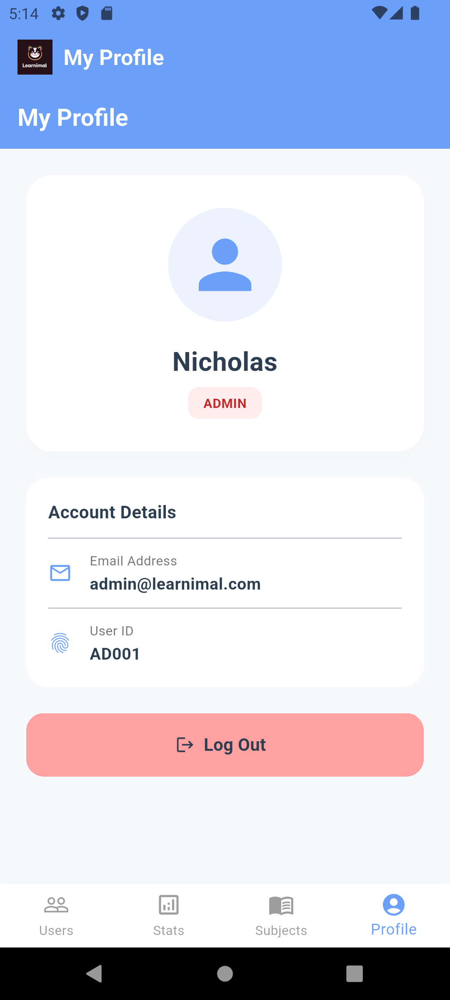

# Learnimal

**CT088-3-2-MAE | Dart/Flutter | Group Project (Group 6)**

A mobile learning application for teachers, students, and administrators with study tracking, classroom management, and goal setting.

## Overview

Learnimal is a cross-platform mobile application built with Flutter for the Mobile App Engineering course. The app supports three user roles (Teacher, Student, Admin) with features including study session tracking (Pomodoro), classroom management, goal setting, progress monitoring, feedback collection, and administrative analytics.

**My Contribution**: Admin features and sign-in/authentication system.

## Features

### Authentication (My Implementation)
- **Login System**: Email/password sign-in using Firebase
- **Role Detection**: Automatic routing to role-specific dashboards (Admin, Teacher, Student)
- **Session Management**: Persistent login state with logout functionality

### Admin Features (My Implementation)
- **User Management**: Add, edit, and delete users with role assignment
- **Subject Management**: Add, edit, and delete subjects
- **Dashboard**: System-wide statistics and health monitoring
- **Profile**: Admin profile viewing and management

### Teacher Features
- Dashboard with classroom overview
- Classroom management and student enrollment
- Analytics with session charts
- Feedback system for students
- Live activity feed

### Student Features
- Dashboard with study overview
- Pomodoro timer for focused study sessions
- Goal setting and tracking
- Progress visualization
- Notifications

### Firebase Integration
- Authentication, cloud services, and real-time data

## Tech Stack

- **Language**: Dart
- **Framework**: Flutter
- **State Management**: Provider / Riverpod (project-dependent)
- **Backend**: Firebase (Auth, Firestore, etc.)
- **Platforms**: Android, iOS, Web, Windows, Linux, macOS

## Project Structure

```
lib/
  main.dart                  — Application entry point
  constants/app_colors.dart   — App color constants
  models/
    classrooms.dart           — Classroom data model
    feedback.dart             — Feedback data model
    study_sessions.dart       — Study session data model
  repositories/
    admin_repository.dart     — Admin data operations
    classroom_repository.dart — Classroom data operations
    feedback_repository.dart  — Feedback data operations
    goals_repository.dart     — Goals data operations
    reward_repository.dart    — Rewards data operations
    student_repository.dart   — Student data operations
    study_repository.dart     — Study data operations
    teacher_repository.dart   — Teacher data operations
  screens/
    login_page.dart           — Authentication screen (My contribution)
    admin_dashboard.dart      — Admin main screen (My contribution)
    admin_manageSubjectsPage.dart — Subject management (My contribution)
    admin_manageUsersPage.dart — User management (My contribution)
    admin_profilePage.dart    — Admin profile (My contribution)
    admin_statisticsPage.dart — Statistics dashboard (My contribution)
    student_dashboard.dart    — Student main screen
    student_goalsPage.dart
    student_notificationsPage.dart
    student_pomodoroPage.dart
    student_progressPage.dart
    teacher_dashboard.dart    — Teacher main screen
    teacher_analytics.dart
    teacher_classroom.dart
    teacher_feedback.dart
    teacher_studentview.dart
  widgets/
    student_goal_card.dart
    student_progress_bar.dart
    student_timer_button.dart
    teacher_classroom_dropdown.dart
    teacher_pomodoro_panel.dart
    teacher_sidebar.dart
android/                     — Android platform files
ios/                         — iOS platform files
web/                         — Web platform files
linux/                       — Linux platform files
macos/                       — macOS platform files
windows/                     — Windows platform files
firebase.json                — Firebase configuration
pubspec.yaml                 — Flutter dependencies
```

## Prerequisites

- Flutter SDK (3.0 or later)
- Dart SDK
- Android Studio / Xcode (for mobile development)
- Firebase project setup

## Build & Run

```bash
# Check Flutter setup
flutter doctor

# Run on connected device/emulator
flutter run

# Run with specific target
flutter run -d chrome  # Web
flutter run -d windows  # Windows
flutter run -d android  # Android
```

## Usage

### Login (My Implementation)
1. Launch the app and log in with your credentials
2. The system detects your role and routes you to the appropriate dashboard

### Admin Workflow (My Implementation)
1. **Dashboard**: View system-wide statistics and user overview
2. **Manage Users**: Add, edit, or delete users and assign roles
3. **Manage Subjects**: Add, edit, or delete subjects in the system
4. **Profile**: View and manage admin profile settings

## Screenshots

### Admin Screens

| Screen | Screenshot |
|--------|------------|
| Admin Dashboard (Manage Users) |  |
| Admin Dashboard (Statistics) |  |
| Admin Dashboard (Manage Subjects) |  |
| Admin Profile |  |
| Add/Edit User Dialog |  |
| Delete User Confirmation |  |
| Add/Edit Subject Dialog |  |
| Delete Subject Confirmation |  |
| System Health Check |  |


## Concepts / Design Notes

### Architecture

The app follows a repository pattern for data management:
- **Repositories**: Abstract data access layer for each entity type
- **Models**: Data classes for domain entities
- **Screens**: Feature-specific UI screens
- **Widgets**: Reusable UI components

### Firebase Integration

- Firebase Authentication for user management
- Firestore for data persistence
- Firebase Messaging for push notifications
- Firebase configuration in `firebase_options.dart`

### Authentication Design

The sign-in system uses Firebase for authentication:
- **Role-based routing**: Login page routes users to role-specific dashboards
- **Session persistence**: Users stay logged in across app restarts
- **Error handling**: Invalid credentials show appropriate error messages

## Author

Ibrahim Bin Mohd Ezman, APU (Group 6)

## License

This project is licensed under the MIT License.
